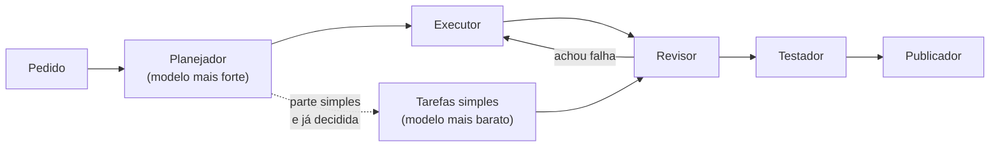

# DevConductor

**Um kit de plugins para o Claude Code que organiza o desenvolvimento com agentes de IA: quem faz cada tarefa, com qual modelo e com quais instruções.**

Junta projetos abertos conhecidos (skills e agentes da comunidade) com uma camada própria de roteamento de modelo, memória, medição de custo e segurança. Uso no dia a dia nos meus próprios projetos, inclusive em landing pages de clientes.

> Este repositório é só a **apresentação** do projeto. O código é privado (veja o fim da página).

---

## Números

| | |
|---|---|
| **11** plugins | núcleo, especialistas por linguagem, segurança, design e mapa do código |
| **Agentes por função** | cada um com modelo e nível de esforço próprios |
| **300+** testes | rodando no GitHub Actions em Linux e Windows a cada envio |

---

## Como uma tarefa anda

Planejar, executar, revisar e decidir a estrutura ficam com o modelo mais forte. Pesquisa, tarefas mecânicas e testes de tela vão para modelos mais baratos. Assim o custo acompanha a dificuldade de cada parte, e não a do pedido inteiro.

---

## O que ele faz

### Agentes por função com roteamento de modelo
Agentes (planejador, executor, revisor, caçador de falha, arquiteto, pesquisador, testador, publicador e outros), cada um com o modelo e o esforço que a função pede.

### Contexto sob medida
Um hook lê os arquivos do projeto (`.csproj`, `package.json`, `pom.xml`, `.py`...) e liga **só** os plugins daquela stack. O agente não carrega instruções de linguagens que o projeto nem usa.

### Medição de uso e custo
Soma tokens por sessão e por modelo, incluindo os subagentes, sem contar a mesma resposta duas vezes. Também mede quanto cada plugin pesa no contexto.

### Verificação de segurança de skills
Toda skill nova passa por um verificador (adaptado do da Sentry) que lê scripts em subpastas, em Node e PowerShell, antes de ser usada. Outro hook confere o que já está instalado.

### Memória e continuidade
Retomada entre sessões (onde paramos, o que falta) e troca de turno com outra ferramenta de IA quando o limite de uso acaba.

### Publicação com vitrine
Envia o repositório e, quando o projeto pede, gera uma vitrine pública separada, sem histórico e com varredura de dados sensíveis antes de publicar.

### Licenças em ordem
Cada arquivo de terceiros tem origem, commit e licença registrados, com crédito no `NOTICE`.

---

## Plugins

| Plugin | O que tem |
|---|---|
| **núcleo** | agentes por função, memória, publicação, roteamento de modelo e verificação de segurança |
| **stacks** (.NET, Java, TypeScript, Python, banco) | especialistas por linguagem e banco, selecionados de projetos abertos |
| **segurança** | código seguro no backend e no frontend e auditoria (OWASP, dependências, segredos) |
| **landing pages** | fluxo completo de landing page, da coleta à publicação, com skills de design travadas por etapa |
| **estúdio de design** | estudos de movimento em React + GSAP, testados no computador, no celular e com movimento reduzido |
| **telas de sistema** | telas em React com padrões brasileiros testados (CPF, CNPJ, CEP, dinheiro, datas) |
| **mapa do código** | grafo do código que o agente consulta antes de abrir dezenas de arquivos |

O método de trabalho (brainstorm, plano, TDD e revisão) vem do plugin aberto *superpowers*.

---

## Qualidade

- **Mais de 300 testes** com `node --test`, no GitHub Actions, em Linux e Windows, a cada envio.
- Cada plugin passa pela validação oficial do Claude Code; um teste barra plugin alterado sem versão nova.
- Arquivos de terceiros só entram com origem, commit e licença registrados.

---

## Sobre o código

O código é **privado**. Mostro a estrutura e trechos em entrevista.

Contato: [LinkedIn](https://www.linkedin.com/in/neemiasjls/)
